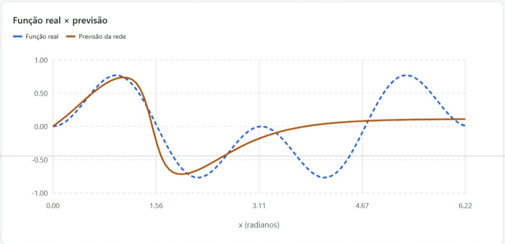
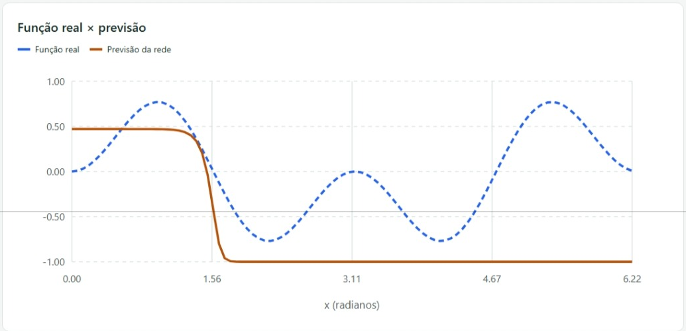
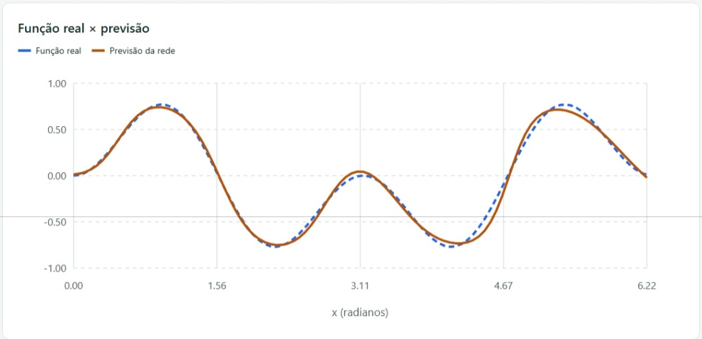
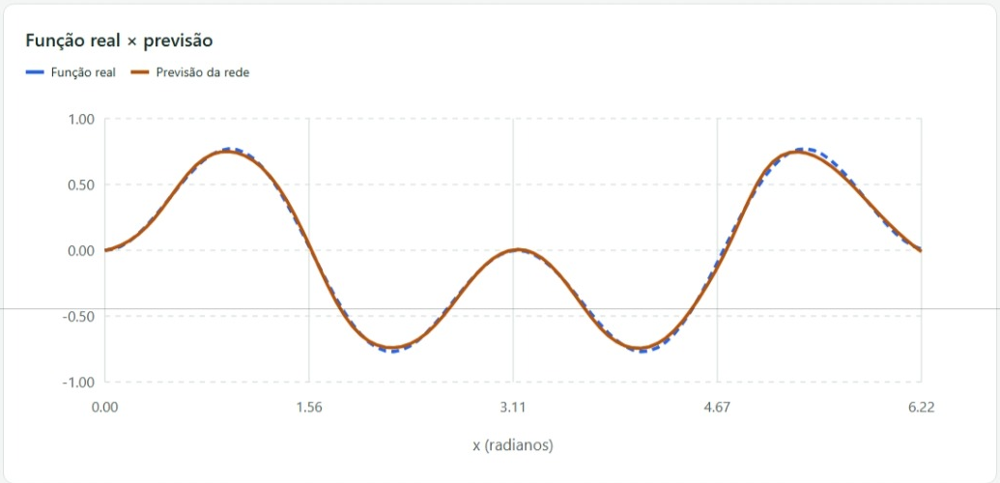

# Aproximação de função com backpropagation

> **Curso:** Ciência da Computação  
> **Disciplina:** Inteligência Artificial

---

**Integrantes**

- Gabryel Henrik Gomes de Barros
- Felipe Mendes Duarte Araújo
- Emelly Vitória Carvalho Caixeta

## 1 - Objetivo

Neste trabalho, desenvolvemos uma rede neural para aproximar a função f(x) = sen(x) × sen(2x). A proposta foi implementar o backpropagation e comparar como a taxa de aprendizagem, o momento, os pesos iniciais e a quantidade de ciclos afetam o resultado.

Realizamos 16 testes. O menor erro quadrático médio (EQM) observado foi aproximadamente **0,000385, no teste 16**. A comparação mostrou que aumentar a taxa, o momento ou a quantidade de ciclos não garante uma melhora proporcional.

## 2 - Implementação

Adaptamos a atividade para Python no backend e Next.js na interface. As somas, a ativação dos neurônios, o cálculo do erro e a atualização dos pesos foram implementados manualmente, **sem NumPy, TensorFlow, PyTorch ou scikit-learn**. A biblioteca math foi usada nas funções matemáticas, random no sorteio dos pesos e FastAPI na comunicação com a interface.

A rede possui uma entrada, dez neurônios ocultos e uma saída, que tenta reproduzir f(x). São dez pesos de entrada, dez bias ocultos, dez pesos ligados à saída e um bias da saída, totalizando 31 parâmetros ajustáveis.

A interface permite informar os parâmetros, executar o treinamento e visualizar a função real, a previsão, o histórico do EQM e os pesos finais.

---

## 3 - Funcionamento do treinamento

Geramos 100 amostras igualmente espaçadas no intervalo de zero até 2π, sem incluir o extremo 2π. Para cada índice i, de 0 a 99, calculamos x = i × 2π / 100 e a saída desejada sen(x) × sen(2x). Os valores de x estão em radianos.

Cada neurônio oculto multiplica x pelo seu peso V, soma o bias e aplica a função de ativação sigmoide bipolar. A saída combina as respostas dos dez neurônios usando os pesos W, soma seu único bias e aplica a mesma ativação. Essa função produz valores entre −1 e 1.

O erro de cada amostra é a saída desejada menos a previsão. Com esse erro e a derivada da ativação, calculamos o delta da saída e o propagamos para a camada oculta, usando os pesos W antes da atualização.

Cada peso é ajustado usando a taxa, o delta e a entrada da conexão. O momento acrescenta uma parte do ajuste anterior; com momento zero, essa contribuição é desativada. O bias segue a mesma regra, com entrada constante igual a 1.

Um ciclo corresponde à passagem pelas 100 amostras, sempre na mesma ordem. Os pesos são atualizados após cada amostra. Ao final do ciclo, calculamos o EQM usando a rede já atualizada: somamos os quadrados das diferenças entre as saídas desejadas e previstas e dividimos por 100. O treinamento termina ao completar os ciclos solicitados, sem parada antecipada por uma meta de erro.

## 4 - Organização dos testes

Começamos com taxa 0,5, momento 0,05, 35.000 ciclos, pesos iniciais entre −1/3 e +1/3 e semente 42. Em cada etapa, alteramos somente o parâmetro estudado. A configuração escolhida em uma etapa serviu de referência para a seguinte. Não testamos todas as combinações possíveis.

Mantivemos a semente 42 nos primeiros 14 testes para controlar o sorteio inicial. Nos dois últimos, usamos 7 e 123. Cada treinamento começou novamente dos pesos sorteados, sem continuar a execução anterior. Os tempos registrados são de uma execução por configuração, no computador usado nos testes.

---

## 5 - Resultados e análise

Os valores de EQM das tabelas estão arredondados para seis casas decimais. Os registros completos e as capturas de cada execução acompanham a planilha de testes.

### 5.1 - Taxa de aprendizagem

Mantivemos momento 0,05, 35.000 ciclos, limite inicial ±1/3 e semente 42.

| Teste | Taxa | EQM final | Tempo |
|---|---:|---:|---:|
| 1 | 0,5 | 0,121028 | 58,18 s |
| 2 | 0,1 | 0,102581 | 57,28 s |
| 3 | 0,05 | 0,001983 | 57,35 s |
| 4 | 0,005 | 0,021367 | 56,79 s |
| 5 | 0,001 | 0,087509 | 57,81 s |

A taxa 0,05 apresentou o menor EQM dessa etapa. Com 0,5, o erro oscilou e a previsão não acompanhou bem a segunda metade da função. Reduzir para 0,005 ou 0,001 também não trouxe um resultado melhor dentro dos mesmos 35.000 ciclos. Portanto, a menor taxa não foi automaticamente a melhor.

### 5.2 - Momento

Fixamos taxa 0,05 e mantivemos os demais parâmetros da etapa anterior. Reaproveitamos o teste 3 como referência.

| Teste | Momento | EQM final | Tempo |
|---|---:|---:|---:|
| 6 | 0 | 0,001930 | 58,32 s |
| 3 | 0,05 | 0,001983 | 57,35 s |
| 7 | 0,5 | 0,261878 | 58,21 s |
| 8 | 0,9 | 0,730413 | 58,35 s |

Sem momento, o EQM ficou um pouco menor que com momento 0,05. Essa diferença foi pequena. Já os valores 0,5 e 0,9 prejudicaram bastante o resultado nessa configuração. No teste 8, o gráfico do erro apresentou fortes oscilações e a saída ficou próxima de −1 em grande parte do intervalo. O momento não melhorou o treinamento em todas as situações.

---

### 5.3 - Limite dos pesos iniciais

Mantivemos taxa 0,05, momento zero, 35.000 ciclos e semente 42. O limite define apenas o intervalo do sorteio inicial. Ele não impede que os pesos ultrapassem esse intervalo durante o treinamento.

| Teste | Limite inicial | EQM final | Tempo |
|---|---:|---:|---:|
| 9 | ±0,1 | 0,255104 | 58,42 s |
| 6 | ±1/3 | 0,001930 | 58,32 s |
| 10 | ±0,5 | 0,001942 | 58,51 s |
| 11 | ±1 | 0,002302 | 58,80 s |

O limite ±1/3 apresentou o menor EQM dessa comparação, praticamente empatado com ±0,5. Com ±0,1, a previsão ficou quase uma reta, sem reproduzir as oscilações da função. Isso mostrou que começar com pesos menores não garantiu melhor aprendizado. Ao mudar o limite, alteramos os valores iniciais, mesmo mantendo a semente.

### 5.4 - Quantidade de ciclos

Fixamos taxa 0,05, momento zero, limite inicial ±1/3 e semente 42.

| Teste | Ciclos | EQM final | Tempo |
|---|---:|---:|---:|
| 12 | 5.000 | 0,094170 | 8,36 s |
| 13 | 15.000 | 0,006989 | 25,10 s |
| 6 | 35.000 | 0,001930 | 58,32 s |
| 14 | 70.000 | 0,001846 | 117,03 s |

Com 5.000 ciclos, a rede ainda não acompanhava bem a segunda metade da função. Com 15.000, a aproximação melhorou bastante. O histórico mostra que uma fase aparentemente estável não significava que o treinamento tinha terminado de melhorar.

Passar de 35.000 para 70.000 ciclos reduziu o EQM de aproximadamente 0,001930 para 0,001846, uma redução de cerca de 4,4%, mas o tempo praticamente dobrou. Para essa semente, 35.000 ciclos tiveram um bom equilíbrio entre erro e tempo. Os 70.000 ciclos produziram um erro um pouco menor.

---

### 5.5 - Sementes diferentes

Nesta comparação complementar, mantivemos taxa 0,05, momento zero, 70.000 ciclos e limite inicial ±1/3. Alteramos apenas a semente, que determina os valores sorteados no início.

| Teste | Semente | EQM final | Tempo |
|---|---:|---:|---:|
| 14 | 42 | 0,001846 | 117,03 s |
| 15 | 7 | 0,001096 | 117,07 s |
| 16 | 123 | 0,000385 | 118,86 s |

As três execuções produziram boas aproximações, com erros diferentes. A semente 123 apresentou o menor EQM dos 16 testes. Os pesos de partida influenciaram o resultado, mas isso não torna essa semente a melhor para qualquer situação.

## 6 - Conclusão

Conseguimos aproximar a função com o backpropagation manual em Python. Taxas e momentos maiores não garantiram melhores resultados, e o ganho com mais ciclos dependeu da etapa do treinamento.

A melhor execução observada foi o teste 16, com taxa 0,05, momento zero, 70.000 ciclos, limite inicial ±1/3 e semente 123. A previsão acompanhou de perto a função real e o EQM final ficou em aproximadamente 0,000385.

**O EQM apresentado foi calculado nas próprias 100 amostras usadas no treinamento. Ele não é um percentual de acerto.** Como não separamos um conjunto de teste, esses resultados não comprovam o desempenho em entradas inéditas. Também usamos apenas uma execução por configuração e três sementes na comparação final, então as conclusões ficam limitadas aos testes realizados.

## Referências

INTELIGÊNCIA ARTIFICIAL. Aula 07 Outubro. Material didático da disciplina, arquivo 08.

INTELIGÊNCIA ARTIFICIAL. Aula 22 Outubro. Material didático da disciplina, arquivo 09.

---

## Apêndice A Comparações visuais

As imagens são recortes das capturas originais, com as cores preservadas. A linha azul tracejada representa a função real e a linha marrom contínua representa a previsão. As capturas completas incluem os parâmetros, o histórico do erro e os pesos finais.

**Figura 1 — Teste 1 com taxa 0,5 e EQM 0,121028**

*Fonte: captura da execução do teste 1.*

**Figura 2 — Teste 8 com momento 0,9 e EQM 0,730413**

*Fonte: captura da execução do teste 8.*

---

**Figura 3 — Teste 14 com semente 42 e EQM 0,001846**

*Fonte: captura da execução do teste 14.*

**Figura 4 — Teste 16 com semente 123 e EQM 0,000385**

*Fonte: captura da execução do teste 16.*

Nos testes 14 e 16, as curvas ficaram próximas em todo o intervalo mostrado. O teste 16 apresentou o menor EQM entre as configurações avaliadas, mas ainda existem pequenas diferenças entre a previsão e a função real.
